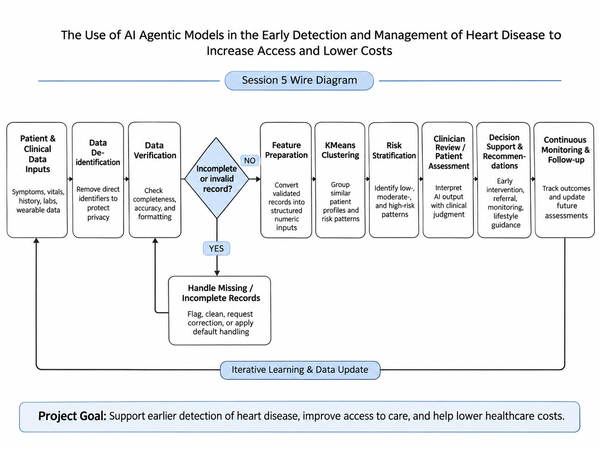

# AI Agentic Models for Early Detection and Management of Heart Disease

[](https://github.com/kemeishaellis/ai-heart-disease-early-detection/actions/workflows/tests.yml?query=branch%3Amain)

## Project Overview

This project explores how agentic AI models can support the early detection and management of heart disease, improve healthcare access, and reduce healthcare costs.

## Project Objectives

- Identify potential risk factors for heart disease.
- Support the analysis of patient health information.
- Assist healthcare professionals with early risk assessments.
- Improve access to preventive healthcare services.

## Proposed Workflow

The proposed system involves collecting and de-identifying patient information, verifying data quality, handling incomplete records, performing risk assessments, and supporting continuous monitoring.

## Inputs and Outputs

Inputs include de-identified patient health information and relevant clinical indicators.

Proposed outputs include heart disease risk assessments and alerts for review by healthcare professionals.

## Running Unit Tests

Install dependencies:

```bash
python -m pip install -r requirements.txt
```

Run tests:

```bash
python -m pytest -v
```

## Project Status

This is an educational design project and is not a clinically validated diagnostic tool.

## Session 5 Wire Diagram

This diagram shows the proposed workflow of the AI agentic system for early detection and management of heart disease.

It begins with patient data collection, followed by data de-identification and verification. Incomplete records are handled before further processing.

The system then uses KMeans clustering to group similar patient profiles. The results support risk assessment, clinician review, and follow-up monitoring.


