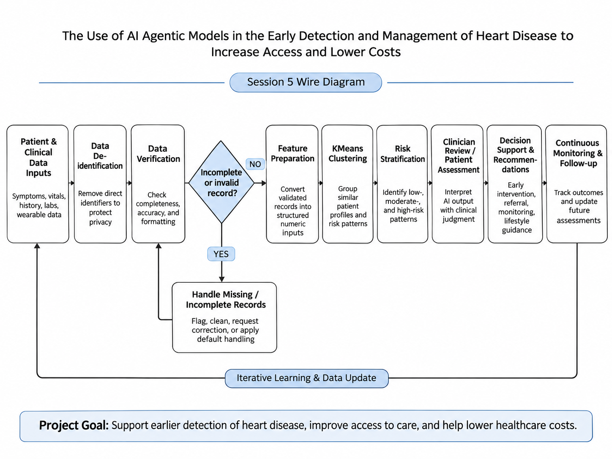

# AI Agentic Models for Early Detection and Management of Heart Disease

[](https://github.com/kemeishaellis/ai-heart-disease-early-detection/actions/workflows/tests.yml?query=branch%3Amain)

## Project Overview

This project explores how agentic AI models can support the early detection and management of heart disease, improve healthcare access, and reduce healthcare costs.

## Project Objectives

- Identify potential risk factors for heart disease.
- Support the analysis of patient health information.
- Assist healthcare professionals with early risk assessments.
- Improve access to preventive healthcare services.

## Proposed Workflow

The proposed system involves collecting and de-identifying patient information, verifying data quality, handling incomplete records, performing risk assessments, and supporting continuous monitoring.

## Inputs and Outputs

Inputs include de-identified patient health information and relevant clinical indicators.

Proposed outputs include heart disease risk assessments and alerts for review by healthcare professionals.

## Running Unit Tests

Install dependencies:

```bash
python -m pip install -r requirements.txt
```

Run tests:

```bash
python -m pytest -v
```

## Project Status

This is an educational design project and is not a clinically validated diagnostic tool.

## Session 5 Wire Diagram

This diagram shows the proposed workflow of the AI agentic system for early detection and management of heart disease.

It begins with patient data collection, followed by data de-identification and verification. Incomplete records are handled before further processing.

The system then uses KMeans clustering to group similar patient profiles. The results support risk assessment, clinician review, and follow-up monitoring.



## Session 11 component-by-component tests

The runnable Session 11 prototype is **fictional-data only**. It is not a medically
validated risk estimator, HIPAA compliance tool, live EHR integration or clinician
approval service. See [Session 11 instructions](SESSION11.md) for the run commands.

Run the targeted suite:
    python -m pytest test_session11_workflow.py test_session11_component_contracts.py -v -ra

GitHub Actions automatically runs these tests via
[Session 11 synthetic workflow](.github/workflows/session11.yml), while
[Unit tests](.github/workflows/tests.yml) discovers the entire repository's suite.

### Unit tests by wire-diagram node

| Node | Function tested | Test identifier |
| --- | --- | --- |
| 1. De-identify reference cohort (atomic protocol candidate) | deidentify_reference_records | test_01_* |
| 2. Check reference-data quality | verify_reference_data | test_02_* |
| 3. Approve reference rules | load_demo_standards | test_03_* |
| 4. Authorize patient-data access | authorize_access | test_04_* |
| 5. Retrieve patient tests and readings | retrieve_patient_data (mock) | test_05_* |
| 6. Normalize and validate patient inputs | verify_patient_data | test_06_* |
| 7. Estimate cardiovascular risk (atomic protocol candidate) | compute_demo_index (toy index) | test_07_* |
| 8. Route safety and eligibility flags | route_for_review | test_08_* |
| 9. Clinician review and escalation | clinician_review_placeholder (mock) | test_09_* |
| 10. Explain approved assessment | explain_result | test_10_* |
| 11. Deliver summary and audit entry | record_output (local only) | test_11_* |
| 12. Review new wearable observations | update_from_wearable (mock) | test_12_* |

These cover normal inputs, missing or invalid data, consent/access restrictions,
decision boundaries, audit privacy and end-to-end synthetic execution.

### Expected failures (xfail): known atomic protocol gaps

Two tests are marked with pytest.mark.xfail(strict=True), execute in GitHub
Actions, and are reported as XFAIL rather than being silently skipped.

1. **test_01_atomic_deidentification_is_really_approved**: the teaching example
   removes selected direct fields but is NOT an approved HIPAA de-identification
   protocol. Replace it with a cited, suitable method and validated tests.
2. **test_07_atomic_clinically_validated_risk_estimator_exists**: the numeric toy
   index is NOT a published cardiovascular risk estimator. The final protocol
   needs a verified implementation, appropriate inputs, population criteria,
   model version and independent unit tests.

All functioning demonstration components are tested. Passing tests with two
documented expected failures does not imply clinical readiness. These two
integration requirements remain pending for any final clinical deployment.
